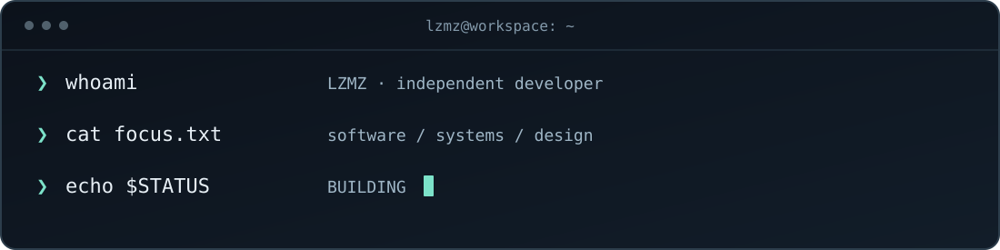

<!-- LZMZ · minimal animated GitHub profile -->

  

  <strong>Design with intention. Build with precision.</strong> 
  Software development · Systems thinking · Creative technology

  <a href="https://github.com/LZMZ-std?tab=overview">Overview</a> &nbsp;·&nbsp;
  <a href="https://github.com/LZMZ-std?tab=repositories">Repositories</a> &nbsp;·&nbsp;
  <a href="https://github.com/LZMZ-std?tab=stars">Stars</a>

 

### About

I'm **LZMZ** — interested in the space where code, engineering and design meet. I value clean interfaces, thoughtful architecture and tools that work reliably outside a demo.

### Technologies

| Languages | Tools & platforms | Areas of interest |
| :-- | :-- | :-- |
| C++ · Python · JavaScript | Git · Linux · Docker | Software engineering |
| SQF · Verilog | Qt · Native tooling | Automation · Creative technology |

### GitHub activity

  

Statistics reflect public activity and are provided by a third-party service; they may occasionally fail to load.

---

LESS NOISE. MORE SIGNAL.

