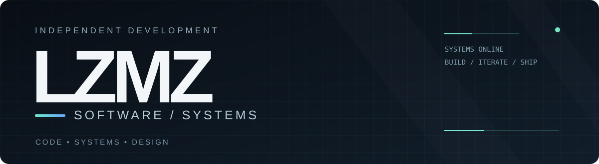
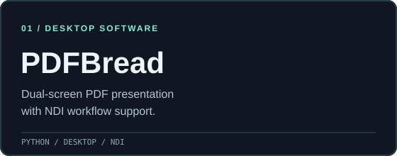
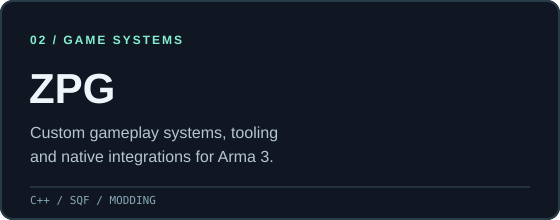

<!-- LZMZ / GitHub profile -->
<p align="center">
  
</p>

<p align="center">
  <b>I build software for the space between code, systems and real life.</b>
  <br />
  <sub>Developer · systems enthusiast · creative technologist</sub>
</p>

<p align="center">
  <a href="https://github.com/LZMZ-std?tab=repositories">Explore my work</a>
  &nbsp;&nbsp;·&nbsp;&nbsp;
  <a href="https://github.com/LZMZ-std/PDFBread">PDFBread</a>
  &nbsp;&nbsp;·&nbsp;&nbsp;
  <a href="https://github.com/LZMZ-std/ZPGCore">ZPGCore</a>
</p>

<br />

### 01 / About

I'm **LZMZ**. I design and develop practical software, from desktop applications and workflow automation to custom game systems and native integrations.

I care about **performance, purposeful interfaces and the details that make tools feel right**. My background in live production also shapes how I approach software: it needs to be dependable when it matters.

<br />

### 02 / Selected projects

<table>
<tr>
<td width="50%" valign="top">
  <a href="https://github.com/LZMZ-std/PDFBread"></a>
</td>
<td width="50%" valign="top">
  <a href="https://github.com/LZMZ-std/ZPGCore"></a>
</td>
</tr>
<tr>
<td valign="top">
  <b><a href="https://github.com/LZMZ-std/PDFBread">View PDFBread →</a></b><br />
  <sub>Presentation and live-production utilities.</sub>
</td>
<td valign="top">
  <b><a href="https://github.com/LZMZ-std/ZPGCore">Explore ZPGCore →</a></b><br />
  <sub>Tooling and infrastructure for the ZPG project.</sub>
</td>
</tr>
</table>

<br />

### 03 / Toolkit

| Area | Technologies |
| :--- | :--- |
| **Development** | C++ · Python · JavaScript · SQF · Verilog |
| **Desktop & systems** | Qt · Linux · Docker · Git |
| **Creative technology** | NDI · live video · audio systems |
| **Focus** | Performance · automation · game tooling · UI engineering |

<br />

### 04 / Current direction

```text
> building reliable desktop tools
> experimenting with native game extensions
> improving interfaces, workflows and performance
```

<br />

<p align="center">
  <sub>LESS NOISE. BETTER SYSTEMS.</sub>
</p>
